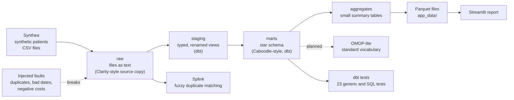

# Patient-360

A governed data platform for sensitive records, built on **synthetic** patient data (Synthea). No real personal data is used anywhere.

The goal is the classic enterprise layout: operational source tables first, normalized tables next, then a reporting star schema, then reports (modeled on how Epic organizes its data). This repo is built in stages.

| Stage | Status |
|---|---|
| 1. Generate synthetic patients, load into DuckDB, build marts, publish a Streamlit report | Done in this starter |
| 2. dbt models and tests on DuckDB | Done |
| 3. Move to Snowflake (raw layer, dbt, masking policies, role-based access) | Week 2 |
| 4. Inject dirty data (duplicate patients, bad dates, negative costs, a renamed column) and merge duplicates with fuzzy matching | Done on DuckDB; repeated on Snowflake in week 2 |
| 5. FHIR in MongoDB, loaded with Airbyte | Week 3 |

## Architecture

The layers follow a proven enterprise pattern, modeled on Epic. Epic stores live data in Chronicles, copies it to Clarity (normalized tables) overnight, and then builds Caboodle (a star schema for reporting). This project mirrors that flow with synthetic data.



| This project | Epic equivalent | What it holds |
| --- | --- | --- |
| `raw` schema | Clarity | Source tables copied as they are, every column as text |
| `staging` | Clarity cleanup | Typed dates, numbers and names, one model per source table |
| `marts` | Caboodle | `dim_patient`, `fact_encounter`, `fact_condition`, `fact_admission` |
| OMOP-lite (planned) | OMOP | Standard concept names so data from different systems can be combined |

## Run it on your computer

You need Python 3.10 or newer and Java 11 or newer (check with `java -version`; if missing, install Temurin from https://adoptium.net).

```bash
git clone https://github.com/agshivam/patient-360.git
cd patient-360

python -m venv .venv
# Windows:  .venv\Scripts\activate
# Mac/Linux: source .venv/bin/activate
pip install -r requirements.txt -r requirements-dev.txt

python scripts/generate_synthea.py --patients 1000   # about 5 to 10 minutes, downloads Synthea once
python scripts/load_raw.py                            # loads the CSV files as text into the raw layer
(cd dbt && dbt build)                                 # staging views, marts tables, and 23 tests
python scripts/export_app_data.py                     # writes small Parquet files into app_data/
streamlit run app/streamlit_app.py                    # opens the report in your browser
```

Run `dbt docs generate` and `dbt docs serve` inside `dbt/` to browse the lineage graph.

`app_data/` already holds a small sample, so you can run the last command straight away to see the report.

## What each part does

- `scripts/generate_synthea.py` downloads Synthea and creates the patient CSV files in `data/raw/csv/`.
- `scripts/load_raw.py` loads those files into DuckDB as text. It is the only step that reads the CSV files.
- `dbt/models/staging/` has typed views over the raw tables (`stg_patients`, `stg_encounters`, `stg_conditions`, `stg_payers`).
- `dbt/models/marts/` has the star schema (`dim_patient`, `fact_encounter`, `fact_condition`, `fact_admission`) and the small summary tables the app reads.
- `dbt/tests/` has tests written in SQL: SSNs must be masked, encounters must end after they start, stays must be under a year.
- `scripts/export_app_data.py` exports the summary tables as Parquet into `app_data/`.
- `app/streamlit_app.py` is the report. It reads only `app_data/`, so it needs no database and no raw data.

## Publish the report for free (Streamlit Community Cloud)

1. Push this repo to GitHub as a **public** repo named `patient-360`.
2. Go to https://share.streamlit.io and sign in with GitHub.
3. Choose **Create app**, pick the repo, set the main file to `app/streamlit_app.py`, and deploy.
4. Copy the app link into your portfolio.

Free apps can go to sleep when nobody visits and wake when someone opens the link.

## Decisions

- **Raw data loaded as text.** Every raw column is text and each cast is explicit in the dbt staging models, so a changed source column fails loudly instead of silently changing a number.
- **Names and SSNs masked in the marts.** Analysts only ever see initials and the last four SSN digits.
- **dbt owns every transformation.** Models are plain SQL with `ref()` and `source()`, so lineage and tests come for free, and the same models can later run on Snowflake.
- **The app reads small Parquet files.** The report keeps working after any warehouse trial ends, and it deploys without the raw data.
